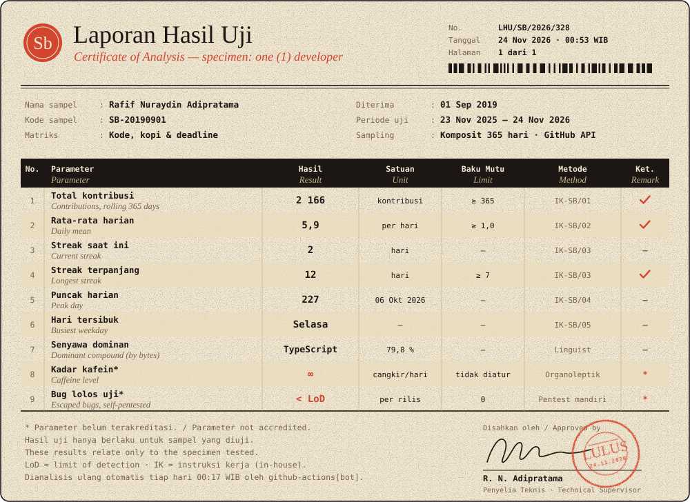
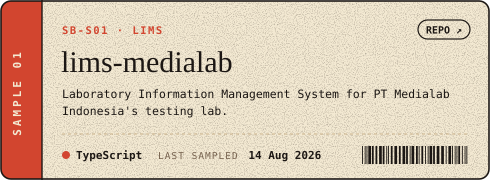
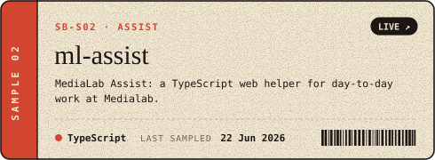
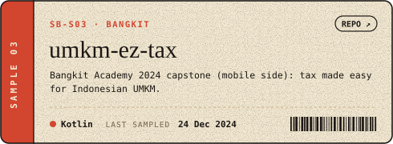
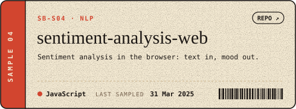
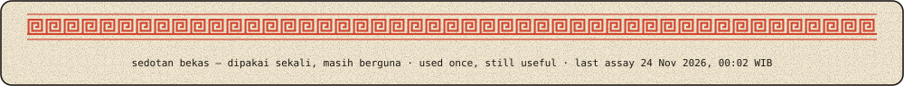

<!--
  LAPORAN HASIL UJI · sedotanbekas · English
  Generated by scripts/build.py — edit scripts/i18n.py (copy) or the CONFIG block in build.py, not this file.
-->

  
  
  
  
  
  
  
  
  
  

  

  <b><i>sedotan bekas</i></b> (n., Indonesian): a used straw. Already used once, still useful.

### `> abstract`

I build the in-house software behind **PT Medialab Indonesia**'s testing lab, most visibly its **LIMS**
(Next.js · Prisma · MariaDB, shipped to Ubuntu with GitHub Actions, PM2 & Nginx). Then I pentest it myself,
so the bugs meet me before they meet anyone else. Informatics Engineering graduate of **Politeknik Negeri Jakarta**
and a Bangkit Academy 2024 alumnus (Mobile Development).

  

  

  

### `> samples on the bench`

  
  
  
  

  

