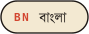
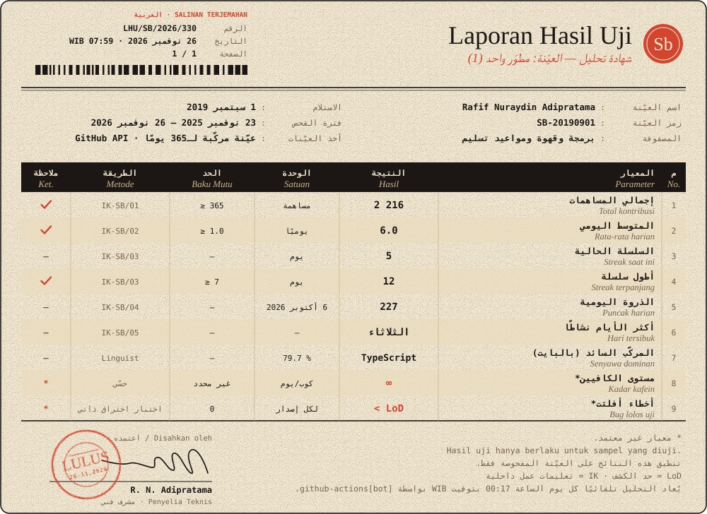
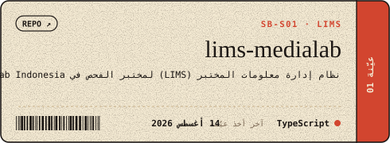
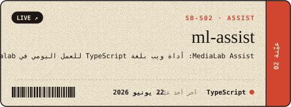
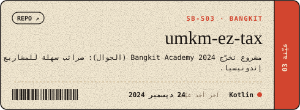
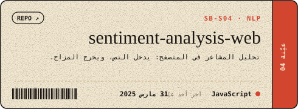
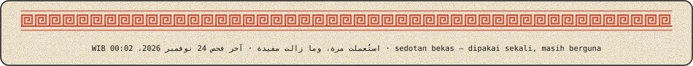

<!--
  LAPORAN HASIL UJI · sedotanbekas · العربية
  Generated by scripts/build.py — edit scripts/i18n.py (copy) or the CONFIG block in build.py, not this file.
-->

  
  
  
  
  
  
  
  
  
  

  

  <b><i>sedotan bekas</i></b> (اسم، بالإندونيسية): ماصّة مستعملة. استُعملت مرة، وما زالت مفيدة.

### `> ملخّص`

أطوّر البرمجيات الداخلية لمختبر الفحص في **PT Medialab Indonesia**، وأبرزها نظام **LIMS** الخاص به
(Next.js · Prisma · MariaDB، ويُنشر على Ubuntu عبر GitHub Actions وPM2 وNginx). ثم أُجري عليه اختبار الاختراق بنفسي،
لكي تصطدم الأخطاء بي قبل أن تصل إلى أي شخص آخر. خرّيج هندسة المعلوماتية من **Politeknik Negeri Jakarta**،
ومن خرّيجي Bangkit Academy 2024 (تطوير تطبيقات الجوال).

  

  

  

### `> عيّنات على طاولة الفحص`

  
  
  
  

  

