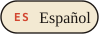
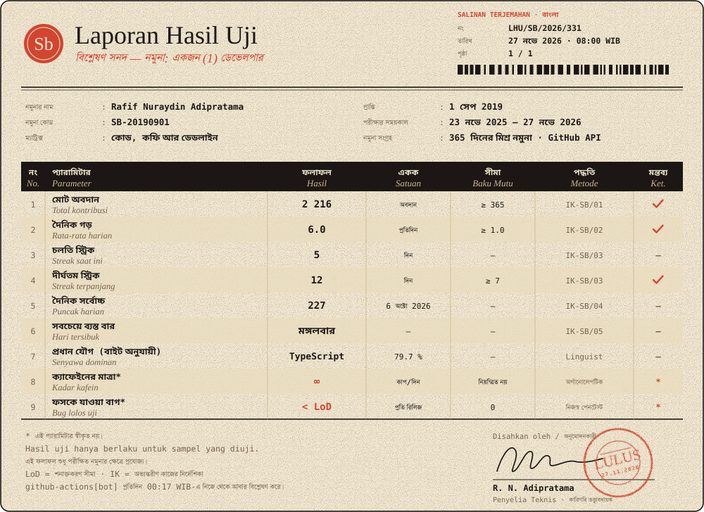
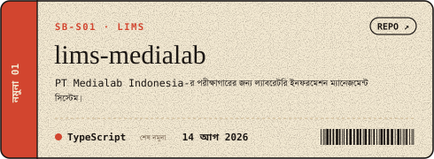
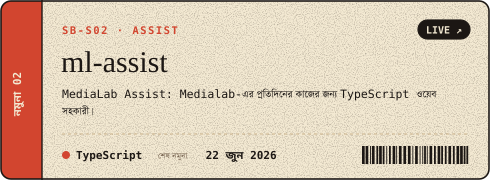
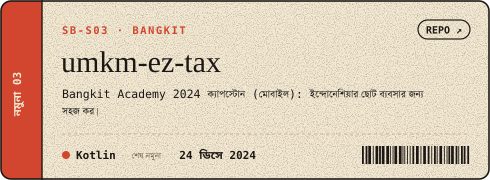
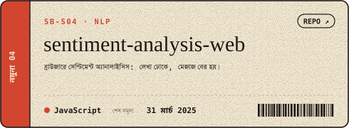
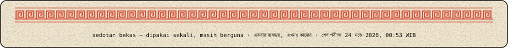

<!--
  LAPORAN HASIL UJI · sedotanbekas · বাংলা
  Generated by scripts/build.py — edit scripts/i18n.py (copy) or the CONFIG block in build.py, not this file.
-->

  
  
  
  
  
  
  
  
  
  

  

  <b><i>sedotan bekas</i></b> (বিশেষ্য, ইন্দোনেশীয়): ব্যবহার করা স্ট্র। একবার ব্যবহার হয়েছে, তবু এখনও কাজের।

### `> সারাংশ`

আমি **PT Medialab Indonesia**-র পরীক্ষাগারের জন্য ইন-হাউস সফটওয়্যার তৈরি করি, যার মধ্যে সবচেয়ে গুরুত্বপূর্ণ হলো এর **LIMS**
(Next.js · Prisma · MariaDB, GitHub Actions, PM2 ও Nginx দিয়ে Ubuntu-তে ডিপ্লয় করা)। তারপর আমি নিজেই সেটার পেনটেস্ট করি,
যাতে বাগগুলো অন্য কারও আগে আমার সামনে পড়ে। **Politeknik Negeri Jakarta** থেকে ইনফরমেটিক্স ইঞ্জিনিয়ারিংয়ে স্নাতক
এবং Bangkit Academy 2024 (মোবাইল ডেভেলপমেন্ট)-এর প্রাক্তন শিক্ষার্থী।

  

  

  

### `> পরীক্ষার টেবিলে নমুনা`

  
  
  
  

  

