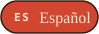
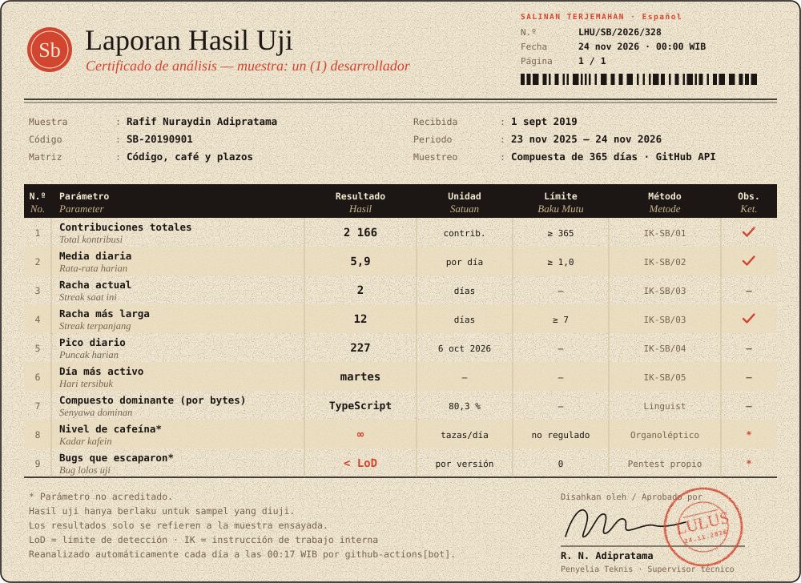
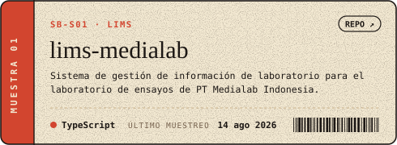
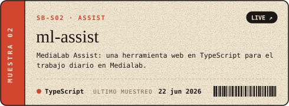
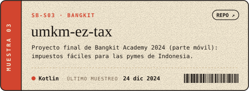
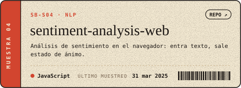
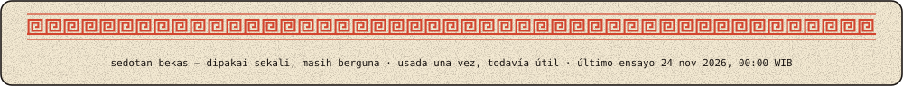

<!--
  LAPORAN HASIL UJI · sedotanbekas · Español
  Generated by scripts/build.py — edit scripts/i18n.py (copy) or the CONFIG block in build.py, not this file.
-->

  
  
  
  
  
  
  
  
  
  

  

  <b><i>sedotan bekas</i></b> (sust., indonesio): una pajita usada. Ya se usó una vez, pero sigue sirviendo.

### `> resumen`

Desarrollo el software interno del laboratorio de ensayos de **PT Medialab Indonesia**, sobre todo su **LIMS**
(Next.js · Prisma · MariaDB, desplegado en Ubuntu con GitHub Actions, PM2 y Nginx). Después le hago pentesting yo mismo,
para que los bugs me encuentren a mí antes que a nadie. Graduado en Ingeniería Informática por la **Politeknik Negeri Jakarta**
y exalumno de Bangkit Academy 2024 (Desarrollo móvil).

  

  

  

### `> muestras en la mesa`

  
  
  
  

  

