<!--
  LAPORAN HASIL UJI · sedotanbekas · Français
  Generated by scripts/build.py — edit scripts/i18n.py (copy) or the CONFIG block in build.py, not this file.
-->

  
  
  <a href="README.hi.md">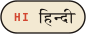</a>
  
  
  
  
  <a href="README.pt.md">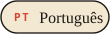</a>
  
  

  

  <b><i>sedotan bekas</i></b> (n., indonésien) : une paille usagée. Déjà servie une fois, toujours utile.

### `> résumé`

Je développe les logiciels internes du laboratoire d’essais de **PT Medialab Indonesia**, à commencer par son **LIMS**
(Next.js · Prisma · MariaDB, déployé sur Ubuntu avec GitHub Actions, PM2 et Nginx). Ensuite, je le pentest moi-même,
pour que les bugs tombent sur moi avant de tomber sur quelqu’un d’autre. Diplômé en génie informatique de la
**Politeknik Negeri Jakarta** et ancien de Bangkit Academy 2024 (Développement mobile).

  <a href="https://rna-r4swy4.38.47.176.211.sslip.io/">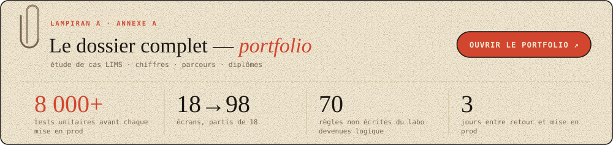</a>

  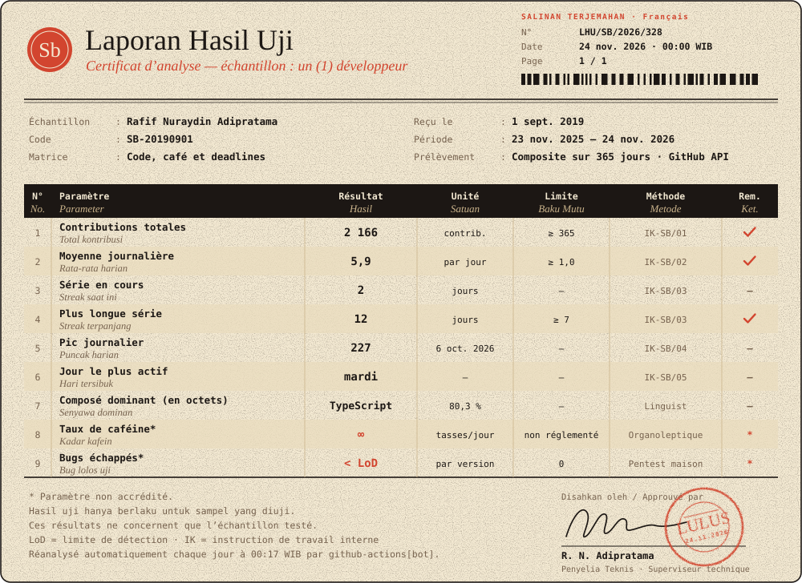

  

  

### `> échantillons sur la paillasse`

  <a href="https://github.com/medialabindonesia/lims-medialab">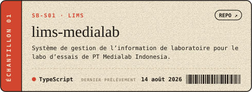</a>
  <a href="https://ml-assist.vercel.app">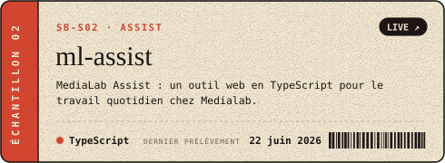</a>
  <a href="https://github.com/sedotanbekas/umkm-ez-tax">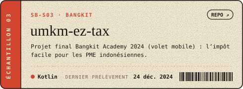</a>
  <a href="https://github.com/sedotanbekas/sentiment-analysis-web">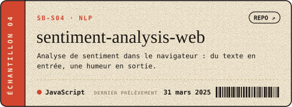</a>

  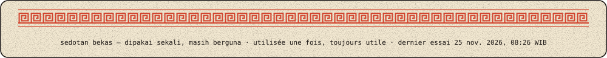

