<!--
  LAPORAN HASIL UJI · sedotanbekas · हिन्दी
  Generated by scripts/build.py — edit scripts/i18n.py (copy) or the CONFIG block in build.py, not this file.
-->

  
  
  
  
  
  
  
  
  <a href="README.ru.md">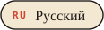</a>
  <a href="README.id.md">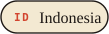</a>

  

  <b><i>sedotan bekas</i></b> (इंडोनेशियाई, संज्ञा): इस्तेमाल की हुई स्ट्रॉ। एक बार इस्तेमाल हुई, फिर भी काम की।

### `> सार`

मैं **PT Medialab Indonesia** की परीक्षण प्रयोगशाला के लिए इन-हाउस सॉफ़्टवेयर बनाता हूँ, जिसमें सबसे अहम है इसका **LIMS**
(Next.js · Prisma · MariaDB, जिसे GitHub Actions, PM2 और Nginx के ज़रिए Ubuntu पर डिप्लॉय किया जाता है)। फिर मैं खुद उसका
पेनटेस्ट करता हूँ, ताकि बग किसी और से पहले मुझसे टकराएँ। **Politeknik Negeri Jakarta** से इन्फ़ॉर्मेटिक्स इंजीनियरिंग में
स्नातक और Bangkit Academy 2024 (मोबाइल डेवलपमेंट) का पूर्व छात्र।

  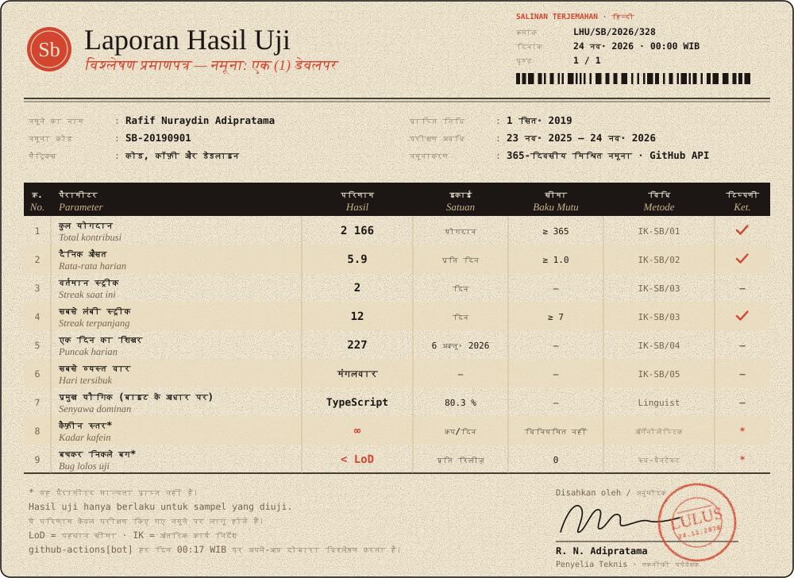

  

  

### `> परीक्षण मेज़ पर नमूने`

  <a href="https://github.com/medialabindonesia/lims-medialab">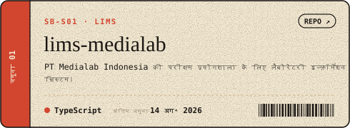</a>
  <a href="https://ml-assist.vercel.app">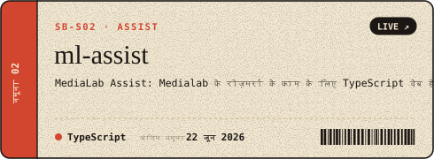</a>
  <a href="https://github.com/sedotanbekas/umkm-ez-tax">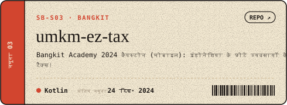</a>
  <a href="https://github.com/sedotanbekas/sentiment-analysis-web">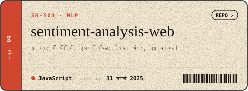</a>

  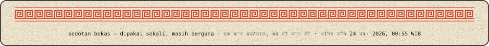

