<!--
  LAPORAN HASIL UJI · sedotanbekas · Indonesia
  Generated by scripts/build.py — edit scripts/i18n.py (copy) or the CONFIG block in build.py, not this file.
-->

  <a href="../README.md">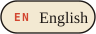</a>
  <a href="README.zh.md">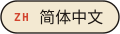</a>
  
  
  <a href="README.ar.md">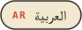</a>
  <a href="README.fr.md">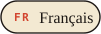</a>
  
  
  
  

  

  <b><i>sedotan bekas</i></b> (kata benda): sudah pernah dipakai, tapi masih berguna.

### `> abstrak`

Aku membangun software internal untuk lab pengujian **PT Medialab Indonesia**, yang paling kelihatan adalah **LIMS**-nya
(Next.js · Prisma · MariaDB, dirilis ke Ubuntu lewat GitHub Actions, PM2 & Nginx). Setelah itu aku pentest sendiri,
supaya bug-nya ketemu aku duluan sebelum ketemu orang lain. Lulusan Teknik Informatika **Politeknik Negeri Jakarta**
dan alumni Bangkit Academy 2024 (Mobile Development).

  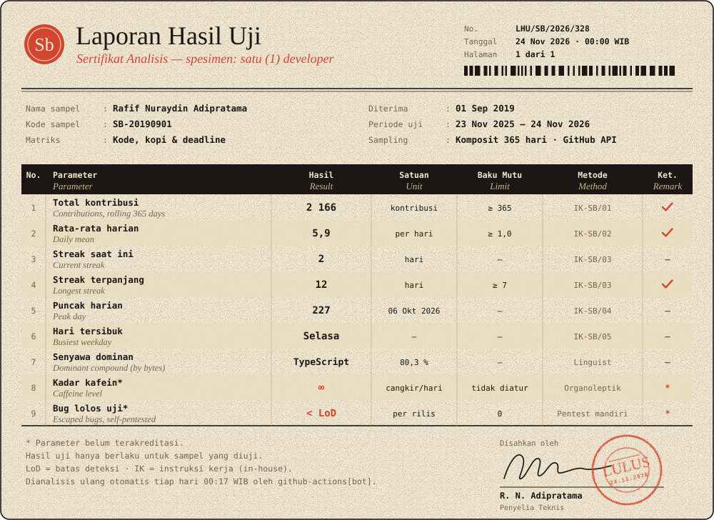

  

  

### `> sampel di meja uji`

  <a href="https://github.com/medialabindonesia/lims-medialab">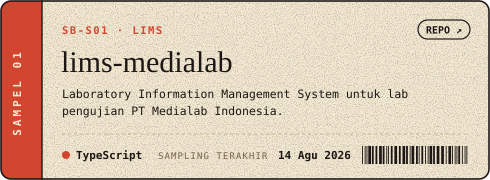</a>
  <a href="https://ml-assist.vercel.app">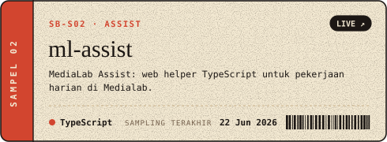</a>
  <a href="https://github.com/sedotanbekas/umkm-ez-tax">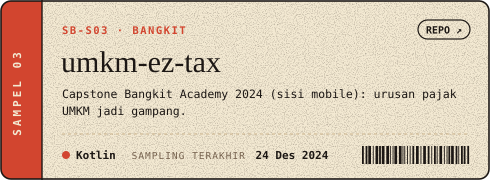</a>
  <a href="https://github.com/sedotanbekas/sentiment-analysis-web">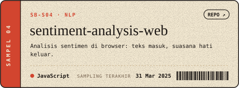</a>

  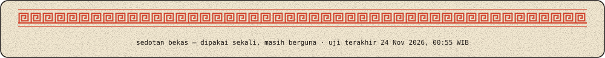

