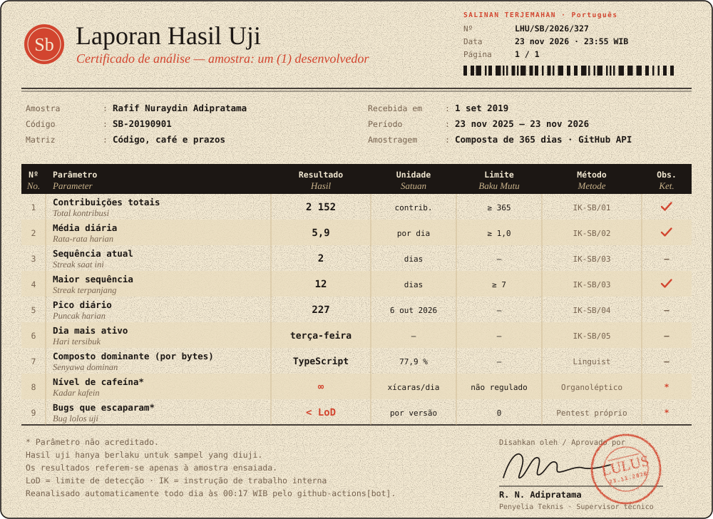
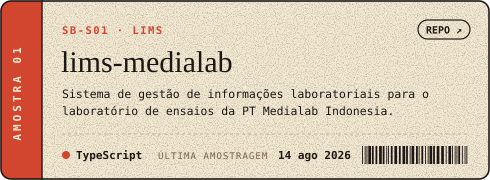
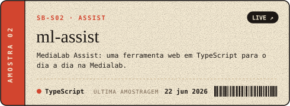
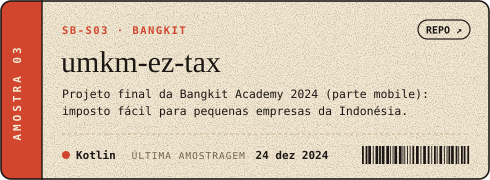
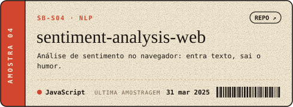
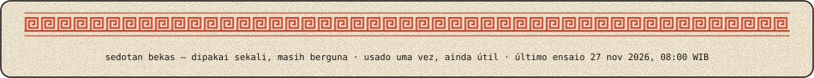

<!--
  LAPORAN HASIL UJI · sedotanbekas · Português
  Generated by scripts/build.py — edit scripts/i18n.py (copy) or the CONFIG block in build.py, not this file.
-->

  
  
  
  
  
  
  
  
  
  

  

  <b><i>sedotan bekas</i></b> (subst., indonésio): um canudo usado. Já foi usado uma vez, mas ainda serve.

### `> resumo`

Desenvolvo os sistemas internos do laboratório de ensaios da **PT Medialab Indonesia**, principalmente o **LIMS**
(Next.js · Prisma · MariaDB, publicado no Ubuntu com GitHub Actions, PM2 e Nginx). Depois eu mesmo faço o pentest,
para que os bugs me encontrem antes de encontrar qualquer outra pessoa. Formado em Engenharia Informática pela
**Politeknik Negeri Jakarta** e ex-aluno da Bangkit Academy 2024 (Desenvolvimento mobile).

  

  

  

### `> amostras na bancada`

  
  
  
  

  

