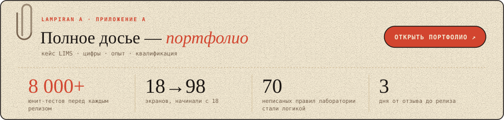
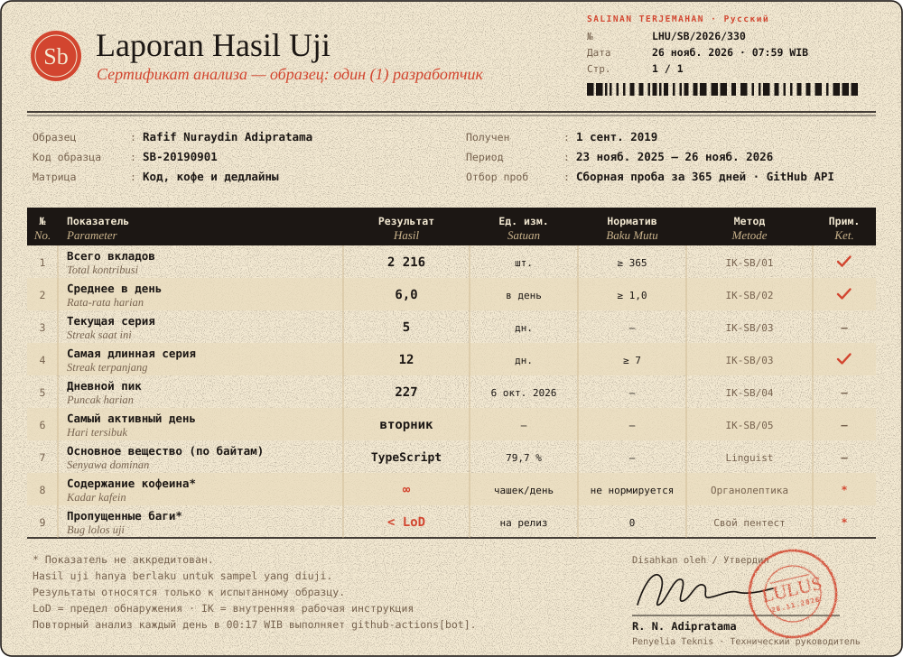
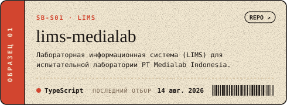
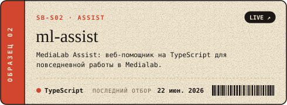
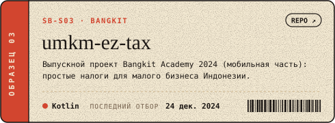
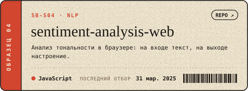
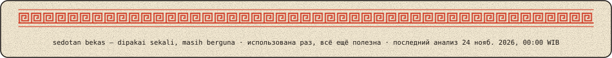

<!--
  LAPORAN HASIL UJI · sedotanbekas · Русский
  Generated by scripts/build.py — edit scripts/i18n.py (copy) or the CONFIG block in build.py, not this file.
-->

  
  
  
  
  
  
  
  
  
  

  

  <b><i>sedotan bekas</i></b> (сущ., индонезийский): использованная трубочка. Уже послужила, но ещё пригодится.

### `> аннотация`

Я разрабатываю внутренние системы для испытательной лаборатории **PT Medialab Indonesia**, прежде всего её **LIMS**
(Next.js · Prisma · MariaDB, развёртывание на Ubuntu через GitHub Actions, PM2 и Nginx). Потом сам провожу её пентест,
чтобы баги встретились со мной раньше, чем с кем-то ещё. Окончил **Politeknik Negeri Jakarta** по специальности
«Информатика», выпускник Bangkit Academy 2024 (мобильная разработка).

  

  

  

  

### `> образцы на лабораторном столе`

  
  
  
  

  

