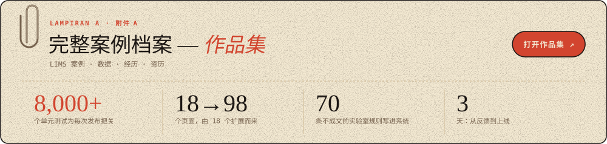
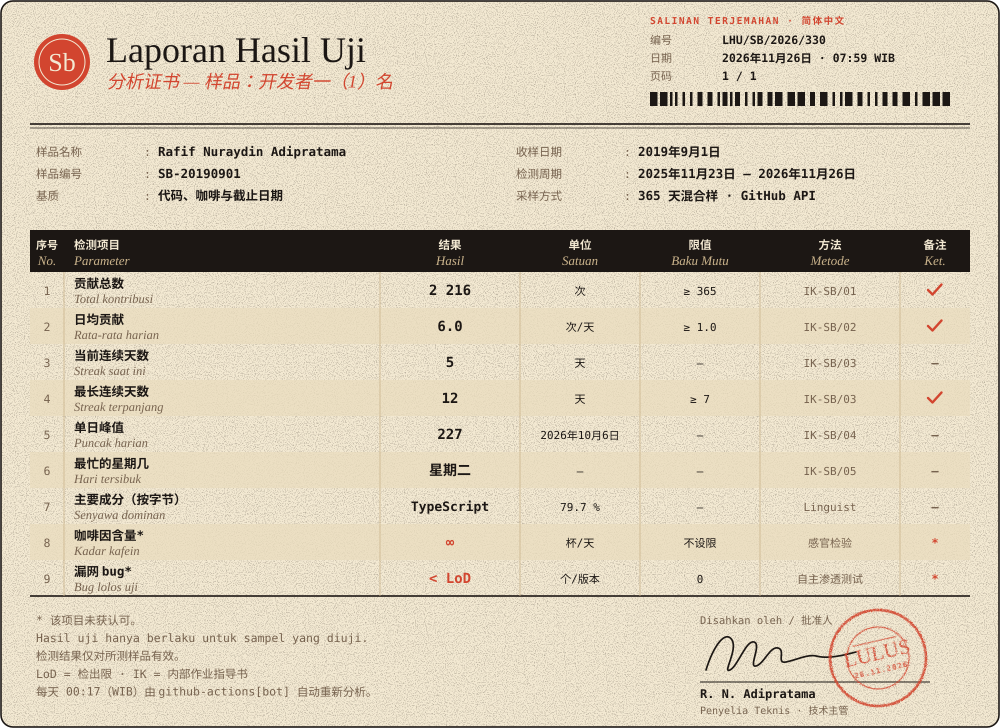
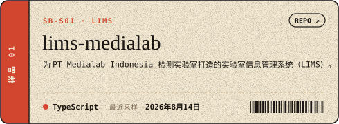
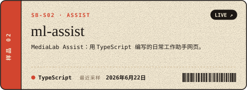
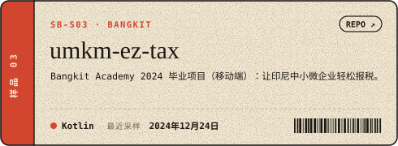
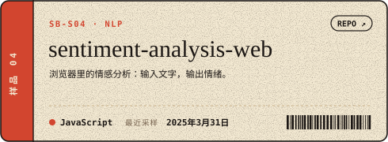
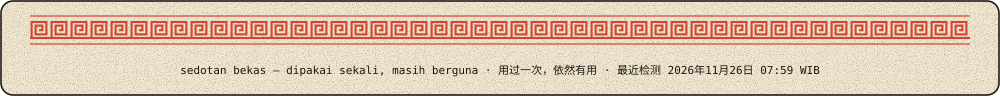

<!--
  LAPORAN HASIL UJI · sedotanbekas · 简体中文
  Generated by scripts/build.py — edit scripts/i18n.py (copy) or the CONFIG block in build.py, not this file.
-->

  
  
  
  
  
  
  
  
  
  

  

  <b><i>sedotan bekas</i></b>（印尼语，名词）：一根用过的吸管。用过一次，依然有用。

### `> 摘要`

我为 **PT Medialab Indonesia** 的检测实验室开发内部软件，其中最核心的是 **LIMS**（Next.js · Prisma · MariaDB，通过 GitHub Actions、PM2 和 Nginx 部署到 Ubuntu）。上线之前，我会亲自对它做渗透测试，让漏洞先撞上我，而不是别人。毕业于 **Politeknik Negeri Jakarta** 信息工程专业，Bangkit Academy 2024 学员（移动开发方向）。

  

  

  

  

### `> 检测台上的样品`

  
  
  
  

  

